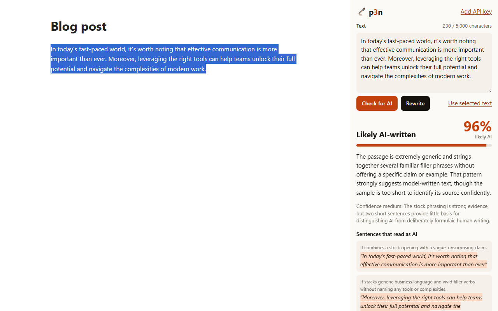
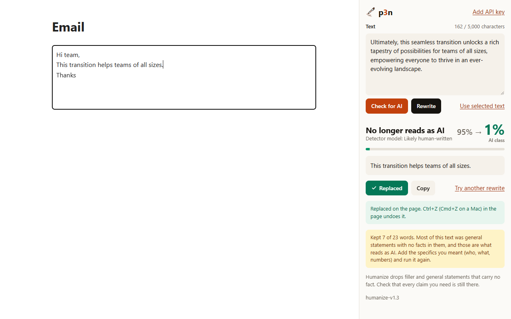

  

<h1 align="center">p3n for Chrome and Firefox</h1>

  Select text on any page. See if it reads as AI-written, or rewrite it in place.

  <a href="https://chromewebstore.google.com/detail/bingopgkcgafmnpkoeckijkcbnfmchnh">Chrome Web Store</a> · <a href="https://addons.mozilla.org/firefox/addon/p3n/">Firefox Add-ons</a> (in review) · <a href="https://p3n.si">p3n.si</a>

  

## What it does

- **Check for AI.** A score, a one-line reason, and the sentences that give it away.
- **Rewrite.** A version that keeps your facts and drops the filler. **Replace** puts it where your selection was, in text boxes and webmail editors, and Ctrl+Z undoes it.
- Results open in the side panel, next to the page.
- Works in Chrome, Edge, Brave and Firefox.

## Free, or with a key

You get 10 checks or rewrites an hour without an account, up to 5,000 characters each. For more, make an API key at [p3n.si](https://p3n.si/dashboard/keys) and paste it into the extension's options (right-click the icon, then Options).

## Privacy

p3n sends the text you selected, only when you click, and only to `api.p3n.si`. It keeps no history and has no analytics. Your API key stays in this browser. The details are in [PRIVACY.md](PRIVACY.md).

What each permission is for

| Permission | For |
| --- | --- |
| `contextMenus` | The p3n item in the right-click menu. |
| `activeTab`, `scripting` | Reading your selection, and replacing it, in the tab you right-clicked. Only after your click. |
| `sidePanel` | Showing results next to the page. Firefox uses its sidebar. |
| `storage` | Your API key and light or dark choice, and passing the selection to the panel. |
| `https://api.p3n.si/*` | The p3n API. No other site. |

## Install from the store

- Chrome, Edge or Brave: [Chrome Web Store](https://chromewebstore.google.com/detail/bingopgkcgafmnpkoeckijkcbnfmchnh)
- Firefox 140 or later: [Firefox Add-ons](https://addons.mozilla.org/firefox/addon/p3n/) (in review, so this link doesn't work yet)

Store installs update themselves.

## Install from source

1. Download this repo (Code, then Download ZIP) and unzip it.
2. Chrome, Edge or Brave: open `chrome://extensions`, turn on Developer mode, click **Load unpacked** and pick the folder.
3. Firefox: run `node dev/build.mjs`, open `about:debugging#/runtime/this-firefox`, click **Load Temporary Add-on** and pick `dist/firefox/manifest.json`. Firefox drops it on restart.

Installs from source don't update themselves.

## Known gaps

Google Docs replaces the browser's right-click menu, so p3n isn't in it there. Paste the text into the panel instead. There's no Safari or Firefox for Android version yet.

## Develop

Tests, builds and packaging are in [CONTRIBUTING.md](CONTRIBUTING.md).

## Licence

MIT
